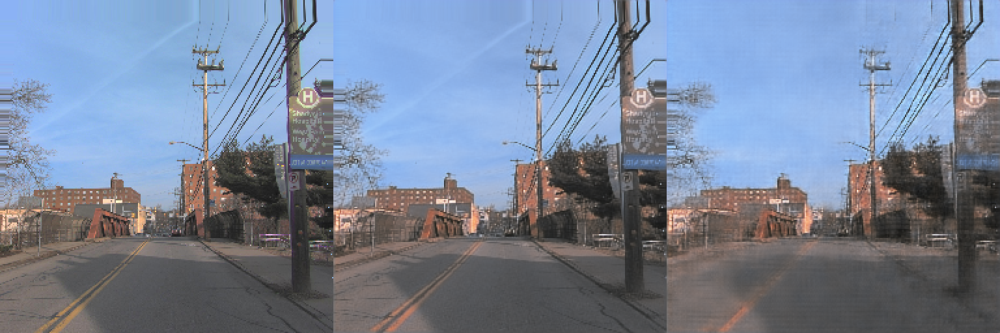
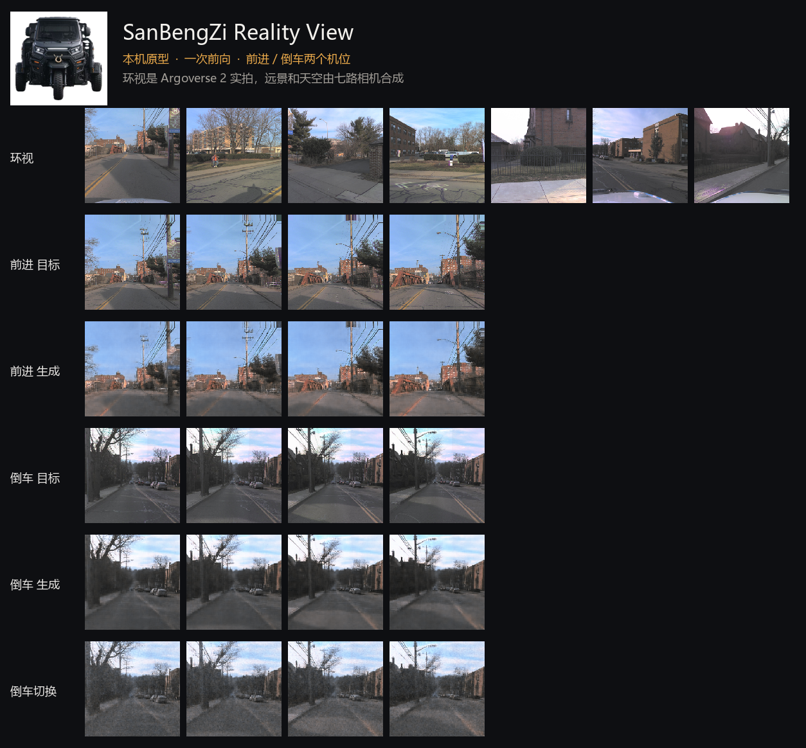
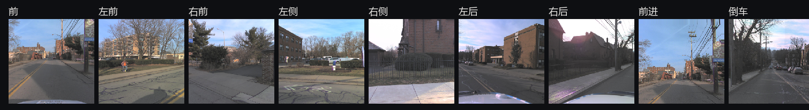

# SanBengZi Reality View

笔记本上的 Reality View 研究原型。用 Argoverse 2 的七路环视，合成车后上方与车前上方两个固定机位的 4 帧画面。环视特征经冻结的 DINOv2 编码，一个约 3160 万参数的视频 MeanFlow 一次前向生成潜变量，再由 2 倍相位解码器回到 256×256。

这不是特斯拉的车端模型。公开信息只说明：任意虚拟相机可以放在车辆上方，画面是新视角合成，不是车顶的实体相机；前进时机位在车后上方，倒车时机位移到车前、镜头看回来。下面的坐标、视场、采样间隔和误差都是这个原型的设计取值或实测，不是特斯拉公布的外参或结构。

## 效果

下面的图和视频都来自当前检查点 `outputs/sbzrv.pt`。场景 0 是一条直街：远处有桥，右侧有电线杆和路牌，路中间是双黄线。

场景 0 的第一帧。从左到右是目标、解码器重建、一次前向。一次前向用的种子与演示视频相同。



八个片段的第一帧预览。自上而下是环视、前进目标、前进生成、倒车目标、倒车生成、倒车切换。这一张是训练结束时另一次抽样，和演示视频不是同一组噪声。



场景 0 的七路环视，以及合成出的前进、倒车目标。



演示视频 358 帧，29.8 秒，12 fps，1280×720。前进一次前向的颜色误差是 0.0241，倒车是 0.0210。

[打开 docs/demo.mp4](docs/demo.mp4)

<video src="docs/demo.mp4" controls width="960" poster="docs/preview.png"></video>

这些文件是当前结果的副本。重新跑演示或预览会写到 `outputs/`，要更新网页上的画面时，再把同名文件拷进 `docs/`。

## 环境

- Windows，NVIDIA GPU。本机按 RTX 4090 Laptop 16 GB 配过。
- Python 3.12
- 项目虚拟环境：`.venv`（不要带 `--system-site-packages`）
- 已验证组合：torch 2.6.0+cu124、torchvision 0.21.0、Pillow、NumPy、imageio 2.38.2、imageio-ffmpeg 0.8.1

训练和演示用虚拟环境里的解释器。重建 Argoverse 缓存要读 feather 标定，需要带 pyarrow 的系统 Python。当前解码器是自训的 2 倍相位网络，演示不下载 VAE。

```powershell
py -3.12 -m venv .venv
.\.venv\Scripts\python.exe -m pip install torch==2.6.0+cu124 torchvision==0.21.0 --index-url https://download.pytorch.org/whl/cu124
.\.venv\Scripts\python.exe -m pip install -r requirements.txt
```

`requirements.txt` 列 Pillow、NumPy、imageio、imageio-ffmpeg。torch 单独安装，避免第二次安装把 CUDA 版换成 PyPI 上的包。

DINOv2 权重不在仓库里。放到 `weights/dinov2_vitb14_pretrain.pth`。公开文件是：

`https://dl.fbaipublicfiles.com/dinov2/dinov2_vitb14/dinov2_vitb14_pretrain.pth`

## 数据

八个白天的 Argoverse 2 Sensor 验证集片段，名单在 `data/av2/scenes.txt`。图像来自公开桶：

`https://argoverse.s3.amazonaws.com/datasets/av2/sensor/val/<log>/`

只用环视相机和标定。不下载 `map/`、`stereo/`，也不读激光雷达。每个片段取 4 帧。

## 运行

在仓库根目录执行。已有权重时直接出演示：

```powershell
$env:HF_HUB_OFFLINE = "1"
.\.venv\Scripts\python.exe -m sbzrv.demo
.\.venv\Scripts\python.exe -m sbzrv.infer
```

演示写到 `outputs/demo.mp4`。`infer` 写 `outputs/preview.png`。权重在 `outputs/sbzrv.pt`，解码器在 `outputs/codec_up8_s128.pt`。

从头训练会先建缓存。缓存导入 `av2.py`，用带 pyarrow 的系统 Python：

```powershell
python -c "import torch; from sbzrv.config import Config; from sbzrv.dataset import build_cache; build_cache(Config(), torch.device('cuda'), rebuild=True)"
```

然后用虚拟环境训练均值流。格子是 128，通道是 8，序列长度 4096。已有的 2 倍解码器会沿用，潜变量均值和方差按当前缓存重算：

```powershell
$env:HF_HUB_OFFLINE = "1"
.\.venv\Scripts\python.exe -m sbzrv.train --codec-arch up --latent-channels 8 --latent-size 128 --steps 6000
```

当前缓存是 `outputs/cache_av2_s8_f4_256_street.pt`，里面的环视特征是每路相机 64 个 token。16 token 的备份在 `outputs/cache_av2_s8_f4_256_street_t16.pt`。`--resume` 只在潜变量尺寸、通道数和这份缓存都不变时接着训。64 格的检查点留在 `outputs/sbzrv_street.pt`。换上 64 token 之前的 128 格检查点留在 `outputs/sbzrv_s128.pt`。射线缓存和带残差的检查点留在 `outputs/cache_av2_s8_f4_256_ray.pt`、`outputs/sbzrv_ray.pt`。不要把它们恢复进当前训练。

## 目录

| 路径 | 内容 |
| --- | --- |
| `sbzrv/av2.py` | 环视读取。追逐射线按方向取环视照片，合成前进 / 倒车目标 |
| `sbzrv/encoder.py` | 冻结的 DINOv2 ViT-B/14 |
| `sbzrv/autoencoder.py` | 2 倍相位解码器，以及片段残差 |
| `sbzrv/model.py` | 视频 MeanFlow，一次前向 |
| `sbzrv/train.py` | 解码器、均值流、残差 |
| `sbzrv/demo.py` | 演示视频 |
| `sbzrv/infer.py` | 预览 |
| `data/av2/scenes.txt` | 八个片段的名单。环视原图在本地，不进仓库 |
| `docs/` | 提交用的效果图和演示视频 |
| `outputs/` | 本地缓存、检查点、重新生成的预览。不进仓库 |
| `weights/` | 本地 DINOv2 权重。不进仓库 |

## 设计取值

| 项目 | 取值 |
| --- | --- |
| 画面 | 4 帧，256×256 |
| 潜变量 | 8×128×128，2×2 tubelet，序列 4096 |
| 网络 | 宽 384，8 层，6 头，约 3160 万参数 |
| 条件 | DINOv2 ViT-B/14 冻结；七路环视，每路 8×8 共 64 个 token |
| 前进机位 | 眼点 (−10, 0, 12) m，看向 (60, 0, −0.2) m，视场 48° |
| 倒车机位 | 眼点 (12.7, 0, 12) m，看向 (−57, 0, −0.2) m，视场 48° |
| 地面 | z = −0.33 m |
| 采样 | 一次前向。换挡从前进潜变量加噪到 0.8，机位改为倒车 |

车体坐标：x 向前，y 向左，z 向上，原点在后轴。引擎盖不画进目标。

## 这八个片段上的实测

2 倍解码器在街道目标上的重建颜色误差是 0.0100，高频误差是 0.0070。均值流在 128 格上先训练 6000 步，再换上每路 64 个环视 token 接着训练 6000 步。一次前向相对目标：前进 0.0241，倒车 0.0210。当前检查点不含片段残差。画面见上面的「效果」。

## 提交到 GitHub 时不包含

仓库里是代码、`data/av2/scenes.txt`、`docs/` 里的效果图和演示视频。下面这些留在本机，`.gitignore` 已排除：

- `.venv/`
- `data/av2/` 里的环视原图和标定。名单在 `scenes.txt`，图像从公开桶现拉
- `weights/dinov2_vitb14_pretrain.pth`
- `outputs/` 里的缓存和检查点。当前 `outputs/sbzrv.pt` 超过 GitHub 单文件 100 MB 上限

## 限制

目标图是环视照片沿追逐方向的投影。前进画面与前相机看到的街道一致，楼和桥保持直立。倒车由左右两台后相机拼成，画面中央有一条淡缝。128 格的重建里，电线和双黄线还在，路牌上的字仍看不清。一次前向已经能分开主要电线，双黄线和楼的轮廓也在，整体仍比目标和重建软。前进颜色误差比重建高出 0.014，倒车高出 0.011。路牌字母还没有回到生成图里。

仓库尚未选择许可证。Argoverse 2 图像、DINOv2 权重各自遵循其发布条款。
